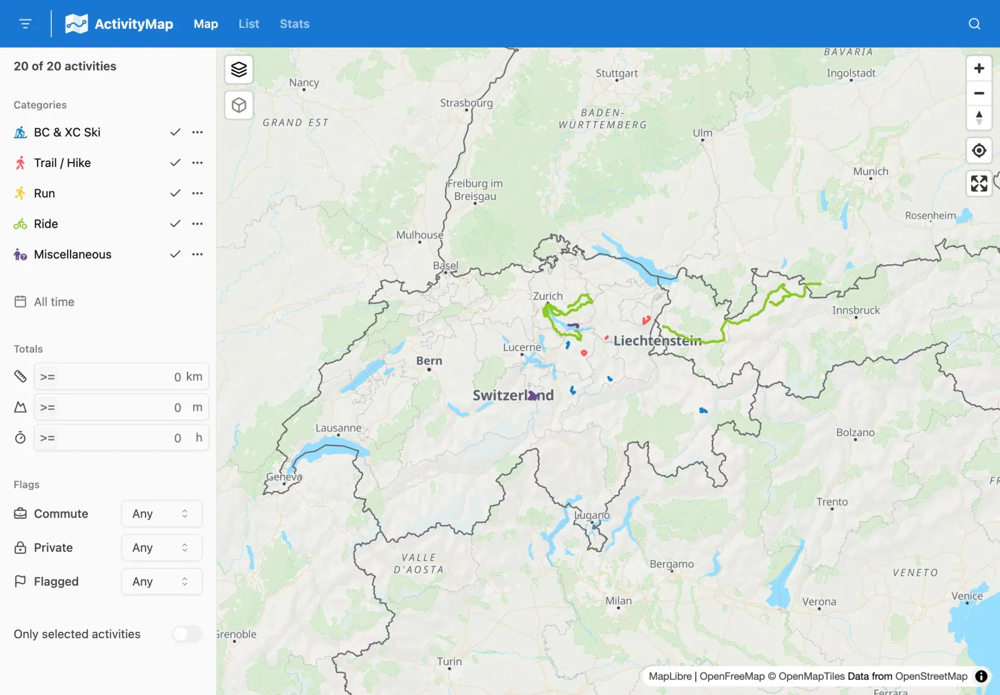
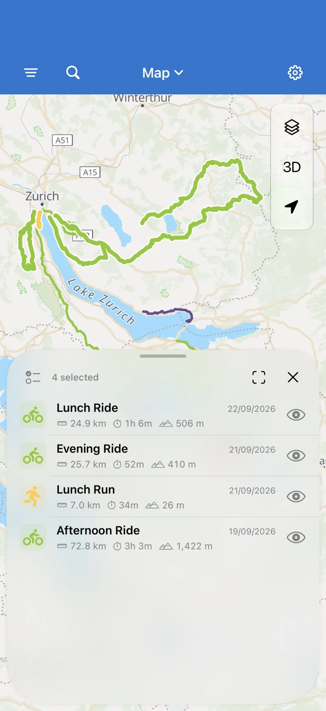
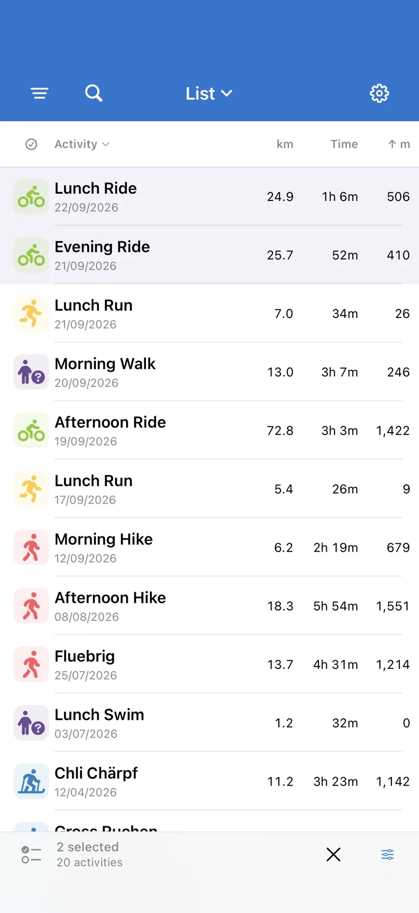
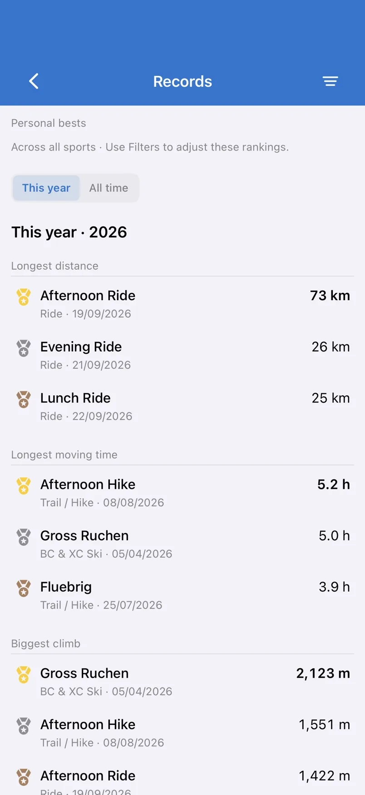

# ActivityMap

Every activity on one map: see your [Strava](https://www.strava.com) runs,
rides, hikes and ski tours on a map, in a list and in stats. ActivityMap is a
web app and a native iPhone and iPad app that share one backend.

[Open the web app](https://activitymap.cc) ·
[About ActivityMap](https://activitymap.cc/about) ·
[Privacy](https://activitymap.cc/privacy) ·
[Support](https://activitymap.cc/support)

  

  
  
  

The screenshots show a synthetic sample library, not a real account.

## Features

### Map

- Every activity drawn together and colored by sport; tap routes to select, fit and inspect them
- 14 base maps in three groups (Worldwide, Switzerland, Norway), including street, outdoor, light, dark, satellite, swisstopo and Norgeskart topographic maps
- Overlays: ski, hiking and cycling routes, slope shading and the NVE avalanche overlay
- 3D view, locate me, and photos from your activities on the map with a gallery
- Matched places (summits, passes, huts) for each route, from an OpenStreetMap catalogue

### List

- Sortable, customizable columns with distance, time and climb
- Previous/next stepping through activities, and a side-by-side detail on iPad

### Stats

- Tiles for recent volume, comparisons with your typical week and month, records, totals, sport mix, hilliness and speed trend
- Expanded training history by week, month and year, and an activity calendar with individual days

### Filter and search

- Filter by sport, date, distance, duration, elevation and activity details
- Search by activity name or by the place a route passed

### Details, editing and sharing

- Route, elevation profile with a position scrubber, and full metrics for every activity
- Edit an activity's name, sport or description and write the change back to Strava
- Export a route as GPX on iOS
- Share selected tracks by a private, expiring link. The link discloses only a fixed set of track fields, hides the first and last 200 m of each route by default, and can be revoked at any time

### Sync and privacy

- Activities stay in sync through Strava [webhooks](https://developers.strava.com/docs/webhooks/), with a periodic reconciliation as the safety net
- The library is cached for offline use on iOS and in the web app's service worker
- Delete your account and data from the app at any time; your activities on Strava are never touched
- The iPhone app has no ads, tracking or analytics SDKs. The rules for how Strava data is stored and removed are in the [Strava data policy](docs/strava-data-policy.md)

## The apps

**Web** (`src/`): a Next.js app at [activitymap.cc](https://activitymap.cc). Signing in with Strava imports and syncs your activities.

**iOS** (`ios/ActivityMap`): a SwiftUI app for iPhone and iPad (iOS 26 or later) that signs in with Strava through a universal link, keeps a local SwiftData cache, and talks to the same backend over `/api/v1`. It ships through TestFlight and is being prepared for the App Store. See the [iOS README](ios/ActivityMap/README.md) for building, running on a device, tests and releases.

## Tech stack

- [Next.js](https://nextjs.org/) 16 (App Router) with React 19, hosted on [Vercel](https://vercel.com/)
- [Convex](https://www.convex.dev/) backend (`backend/`) for the library, its ingestion and the sign-in records
- [better-auth](https://www.better-auth.com/) for Strava OAuth, plus a PKCE code exchange for the native app
- [MapLibre GL JS](https://maplibre.org/) with [react-map-gl](https://visgl.github.io/react-map-gl/) on the web, and MapLibre Native on iOS. Tiles and elevation come from OpenFreeMap, MapTiler and Mapterhorn, plus swisstopo and Kartverket
- [TanStack](https://tanstack.com/) Table, Query and Charts, with Zustand for client state
- [Tailwind CSS](https://tailwindcss.com/) and [Radix UI](https://www.radix-ui.com/) for the web component layer
- SwiftUI, SwiftData and [convex-swift](https://github.com/get-convex/convex-swift) on iOS
- A Cloudflare Worker (`cloudflare/cron`) for scheduled jobs

## Project layout

- `src/app` routes: the signed-in app under `(app)` (`map`, `list`, `stats`), the public `about` page and the `(legal)` privacy, terms and support pages, private `share` links, the sign-in `auth/callback` landing page, and the API routes (`api/v1` is the contract the iOS app uses)
- `src/components` UI, split by feature area (`map`, `list`, `stats`, `settings`, `layout`, `share`)
- `src/server` sign-in, the signed bridges to the backend, Strava access, ingestion and place matching
- `src/store` client-side state (Zustand)
- `backend` the Convex backend: activities, recordings, photos, place matches, ingestion jobs and sign-in records
- `ios/ActivityMap` the SwiftUI app, its unit and UI tests, and build configuration
- `shared` data both clients consume: the map catalogue and styles, the presentation message catalogue, stats rules and the parity fixtures
- `openapi` the generated `/api/v1` OpenAPI document, from which the Swift DTOs are generated
- `public` static assets, including the marketing screenshots in `public/about` and the `.well-known/apple-app-site-association` file for the iOS sign-in link
- `scripts` generators, quality harnesses, the screenshot gallery and TestFlight release scripts
- `cloudflare/cron` the scheduled call that erases accounts whose Strava access was withdrawn
- `docs` design notes, contracts, runbooks and review evidence

## Local development

The app needs a Convex deployment and several gitignored env files to start, including in git worktrees. See [Local development](docs/local-development.md). For the iOS app, see the [iOS README](ios/ActivityMap/README.md); it needs Xcode 27 or newer.

## Quality checks

Run `pnpm check` for static, generated-file and unit checks. Browser and native runtime checks have explicit isolated startup and evidence: see [Quality checks](docs/quality-checks.md). Use `pnpm format:check` for a nonmutating check of changed files.

Generated files are checked by `pnpm check:generated`: the Swift map catalogue, stats tiles, API DTOs and presentation messages. After changing an API route, run `pnpm openapi:generate` and `pnpm api-dtos:generate`. Breaking API changes are caught by `pnpm openapi:check-breaking`; see [API compatibility](docs/api-compatibility-and-deprecation.md).

## Data

An account's library and the app's own records (sign-in, Strava tokens, rate limits) live in the Convex backend; see [backend/README.md](backend/README.md). The app needs `ACTIVITYMAP_CONVEX_SITE` and the bridge keys described there.

A place catalogue is built from OpenStreetMap extracts and published straight to the backend (`pnpm places:prepare`, `places:combine`, `places:publish`); see [Place catalogue preparation and refresh](docs/place-catalogue-refresh.md).

## Releasing the iOS app

A published GitHub release tagged `ios/v…` builds, signs and uploads to TestFlight; see the [TestFlight section of the iOS README](ios/ActivityMap/README.md#testflight-releases). For the App Store:

- [App Store listing and review notes](docs/app-store-listing.md): metadata, description, App Review notes, age rating and the pre-submission checklist
- [App Store privacy answers](docs/app-store-privacy.md): the privacy manifest and questionnaire answers
- [Operational runbook](docs/operational-runbook.md): production failures, webhooks and ingestion

## Legal and Strava

ActivityMap works with your own Strava account and is not made, endorsed or sponsored by Strava. It uses Strava's "Connect with Strava" button and "Powered by Strava" logo, labels links "View on Strava", and is built to follow Strava's API Agreement and [brand guidelines](https://developers.strava.com/guidelines/). The [privacy policy](https://activitymap.cc/privacy), [terms of use](https://activitymap.cc/terms) and [support page](https://activitymap.cc/support) are served from `src/app/(legal)`, with the paths and contact address in `src/lib/legal.ts`.

## Behavior references

- [Accepted navigation contract](docs/navigation-contract.md): containers, history, dismissal, control meanings, baseline-to-target audit and delivery status for #358/#359
- [Navigation implementation verification](docs/navigation-contract-2026-10-11/README.md): browser/simulator results, selected captures and pending device acceptance
- [Navigation behavior baseline](docs/navigation-audit-2026-10-11.md): behavior and evidence captured before implementing the contract
- [Map/list parity contract](docs/map-list-parity-contract.md)
- [Stats parity contract](docs/stats-parity-contract.md)
