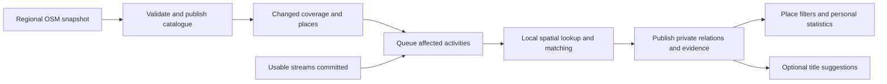

# Places and activity visits

Design proposal, revised 22 October 2026. A foundation for finding and
understanding activities through places: mountains reached, passes visited, huts
encountered, repeat visits and geographical context. Title suggestions are one
optional consumer. The experimental code is not a production importer or a
validated visit detector.

The first implementation is a smaller, manually run backend POC with a frozen
Switzerland catalogue, two core tables and encounter evidence in JSONB. Follow
the [backend implementation plan](activity-places-backend-plan.md). The refresh,
separate source/encounter tables and client synchronization below describe the
later production architecture, not prerequisites for the POC.

## Recommendation

Build a small shared OSM-derived place catalogue in the existing PostgreSQL
database, plus private, versioned relationships between activities and places.
Acquire map data independently of activity ingestion. Start with complete
snapshots of a few supported regions, refreshed weekly; increase to daily if
useful. V1 covers peaks, passes (with distinct road/trail-pass and natural-saddle
subtypes) and mountain huts, all represented by points. Exclude settlements from
v1 extraction, catalogue storage and matching. Defer place-polygon storage and
polygon-based matching; the importer can derive hut points from OSM outlines.

This is technically feasible without a planet database or an Overpass server.
The main engineering work is trustworthy matching, source lifecycle, targeted
recomputation and web/native integration. The public catalogue is likely to be
a smaller storage concern than activity-to-place evidence accumulated across
users. The Swiss snapshot and PostgreSQL measurements below establish a regional
baseline; activity-evidence volume and production update churn remain unmeasured.

Use regional PBF downloads for the first production importer. Keep public
Overpass for bounded experiments; consider an appropriate contracted provider
if on-demand global coverage becomes a requirement. Opening an activity, filter
or statistics screen should never require a live OSM request.

## Product model

| Layer                      | Question                                         | Example                                                                 |
| -------------------------- | ------------------------------------------------ | ----------------------------------------------------------------------- |
| Shared place catalogue     | What is this place and what does the source say? | A peak's names, location, elevation and source identities               |
| Private activity relations | What does the recording support?                 | Reached a summit, visited a pass, passed near a hut, uncertain          |
| Product views              | What should we show or count?                    | Place filters, most frequently reached peaks, markers, suggested titles |

The catalogue is durable reference data with provenance and a refresh process,
not an expendable HTTP cache. Relationships are derived results, with stable
identities, publication guards and retained evidence. A model's selection of an
interesting title destination is not a visit.

First useful features: an activity's places with explanations, a filter for a
specific place, and personal counts. Initially, “most visited mountains” should
mean **activities that reached each mapped peak**. A peak, a massif and a mountain
region are different entities. Massif membership is a later feature with its own
geometry and rules.

Count a place once per activity in the default ranking. Preserve separate
encounter episodes so two visits to the same pass can support an explicitly
labelled “encounters” metric. Distinct visit days are another metric. Scope results
to the actor's accessible activities. Preserve the existing filter contract:
map/list use their saved date range and non-date filters; Stats uses the non-date
filters and its own reporting period, independently of map/list date range and
selection. A selection-specific place summary would be a separate view. Do not
derive a public popularity dataset from private activity membership.

## Place scope and meaning

Choose categories for useful geographical relationships, not title wording.
Keep raw classification tags and a versioned normalized subtype.

| Initial category | Source tags                                      | Supported interpretation                                                        |
| ---------------- | ------------------------------------------------ | ------------------------------------------------------------------------------- |
| Peak             | `natural=peak`                                   | Summit reached, approached, nearby or uncertain                                 |
| Natural saddle   | `natural=saddle`                                 | Visited the mapped saddle; proximity evidence                                   |
| Road/trail pass  | `mountain_pass=yes`                              | Visited the mapped pass; source subtype retained                                |
| Mountain hut     | `tourism=alpine_hut` or `tourism=wilderness_hut` | Arrived near the building or passed nearby; no inference of entering or staying |

OSM distinguishes a [natural saddle](https://wiki.openstreetmap.org/wiki/Tag:natural%3Dsaddle)
from a [pass on a road/path](https://wiki.openstreetmap.org/wiki/Tag:mountain_pass%3Dyes).
They can have different locations and elevations. Display grouping must not turn
a road-pass visit into reaching the adjacent saddle. Elements can have multiple
relevant tags; retain them rather than discarding meaning through precedence rules.

For the initial named-place product, require a usable `name`, a language-specific
`name:*` or `int_name`; measure the excluded unnamed count. Exclude naming metadata
such as `name:signed` rather than treating every `name:*` key as a name. The
[Switzerland measurement](osm-catalog-switzerland-measurement.md) found one such
false positive. Unnamed features can be added
later without changing identity or matching architecture. Store original names,
language names and aliases without inventing translations. A station-only object
does not qualify as a peak; a genuine peak with station metadata still does.

Settlements are entirely deferred, including start/end locality lookup. This
avoids introducing competing meanings of “visited”: near a centre, inside a
municipality or passing through an inhabited area. A future settlement feature
needs its own semantics and geometry; see OSM's [place guidance](https://wiki.openstreetmap.org/wiki/Key:place).

Other later candidates: named lakes, viewpoints, waterfalls and selected mountain
shelters. Each needs a useful relationship: visiting a lake normally concerns
its shoreline, not its centre. Generic shelters, restaurants, stations,
localities, suburbs and neighbourhoods add noise unless a concrete feature needs
them. This is an initial scope choice, not a permanent title-based restriction.

### Geometry and identity

Use an internal stable `place_id`. Preserve source identity as `(osm_type,
osm_id)`, using bigint in PostgreSQL and decimal strings at API boundaries.
`node/123` and `way/123` are distinct. An OSM element ID identifies a source
record, not an enduring real-world destination: representations can be replaced,
split or merged. See [OSM permanent IDs](https://wiki.openstreetmap.org/wiki/Overpass_API/Permanent_ID).

Separate `geo_places` from `geo_place_sources`, initially one source per place.
Allow reviewed mappings of multiple sources to one destination, with reversible
redirects and reconciliation reasons. Names and proximity alone are insufficient
for automatic merging. Recompute affected memberships on merges to avoid duplicate
counts; splits must not copy every old visit to every new place. Preserve the
specific source and subtype underlying an encounter even when display groups it.

Store one representative point per place for v1 lookup, display and matching:

- Use the source coordinates directly for point features.
- For a hut mapped as a building way or multipolygon relation, resolve and
  validate its outline during import, then derive an interior representative
  point using a versioned rule. Preserve source type/ID, point derivation and
  source geometry fingerprint, but do not persist the footprint in the serving
  catalogue. OSM allows both [point and area hut representations](https://wiki.openstreetmap.org/wiki/Tag:tourism%3Dalpine_hut).
- Flag unsupported or invalid representations rather than silently inventing a
  summit/pass location. Overpass `out center` is a bounding-box centre and is not
  a guaranteed interior point or a substitute for the import rule.

Hut matching measures route proximity to this point, using validated thresholds
and uncertainty for GPS error or a nearby path. It supports “reached the hut's
vicinity”, not entry or an overnight stay. Building-footprint matching can wait.
Source outlines are temporary importer inputs; regional clipping polygons remain
coverage metadata. Neither requires storing place polygons in the v1 catalogue.

Use PostGIS for indexed spatial candidate queries; [Neon supports it](https://neon.com/docs/extensions/postgis).
The repository currently uses coordinate arrays and encoded polylines, with no
PostGIS migration: this is an addition to validate. An indexed geography point
and [`ST_DWithin`](https://postgis.net/docs/ST_DWithin.html) support worldwide
metre-based queries. WGS84 geometry degrees must not be treated as metres.
Precise encounter matching can remain in a tested geometry module; PostGIS does
not need to classify visits or store another complete copy of every GPS track.
Validate extension/index migrations on an isolated database branch.

## Acquisition and OSM service compliance

The database licence and distribution-service policies are separate concerns.
Open data does not imply unlimited public API use.

| Source                                  | Role here                                | Constraint                                                         |
| --------------------------------------- | ---------------------------------------- | ------------------------------------------------------------------ |
| Main OSM editing API                    | Occasional source-object investigation   | Not bulk import or synchronization                                 |
| Public Nominatim                        | Not needed for catalogue construction    | No systematic POI harvesting or autocomplete backend               |
| Public Overpass                         | Small development queries and validation | Shared capacity, throttling, no application availability guarantee |
| Regional PBF extracts                   | Recommended initial production source    | Larger downloads and batch processing, with complete bounded input |
| Contracted data API / hosted Overpass   | Optional on-demand coverage              | Must permit persistence, bulk use and intended volume              |
| Self-hosted OSM/Overpass infrastructure | Later if justified                       | Much more infrastructure than a small serving catalogue            |

The [main API policy](https://operations.osmfoundation.org/policies/api/) directs
bulk consumers toward downloads. [Public Nominatim policy](https://operations.osmfoundation.org/policies/nominatim/)
prohibits systematic queries such as downloading all POIs in an area.
[Overpass's operator guidance](https://dev.overpass-api.de/overpass-doc/en/preface/commons.html)
identifies dependence on public instances as a backend for non-mapper apps as
problematic. Its approximate 10,000 requests/1 GB per day guideline is not a
production service entitlement.

For experiments or a provider permitting production requests: use a contactable
application User-Agent, one global request budget, bounded queries/concurrency,
shared in-flight requests, backoff and jitter. Honour throttling; do not rotate
public endpoints to evade limits. HTTP 200 alone does not prove completeness:
reject timeouts, parse failures, incomplete geometry and Overpass `remark`
responses before publication or negative caching.

### Initial production importer

1. Configure supported extract regions covering initial user routes, including
   border buffers. Switzerland and neighbouring Alpine regions are a reasonable
   validation scope, not a permanent restriction.
2. Download a complete regional PBF into a separate batch workspace. Record source
   URL, checksum, source data timestamp, clipping polygon, selector version and
   import status. Download time is distinct from OSM data time.
3. Filter only the v1 peak/pass/hut tags with Osmium, retaining referenced
   nodes/members needed to resolve source representations and derive hut points.
   Normalize into staging point records. Do not retain contributor
   usernames, user IDs or changesets; they serve no product need.
   Also inspect previously retained source IDs in the complete input even if they
   no longer match selection. Otherwise a filtered output cannot distinguish
   present-but-ineligible objects from regional absence.
4. Validate file completeness, point derivation, identities and category counts. Quarantine
   unexplained mass disappearance. In staging, reconcile additions, changes,
   category exits and omissions within the exact coverage and selector scope.
5. Atomically publish changed catalogue rows, region memberships, coverage and
   matching revisions, and the durable change outbox. Serve the last good catalogue
   while imports run or fail. Do not expose new rows before their dependency
   revisions change; deferred queue delivery must not leave old evidence falsely
   current.
6. Enqueue affected activity rematches from the durable change list. Publication and
   invalidation delivery must be idempotent and recover after interruption.

[Geofabrik](https://download.geofabrik.de/technical.html) provides daily extracts
and matching regional updates. Start with complete weekly snapshots. An example
operational target is an alert after two missed imports, with source freshness
visible in diagnostics. Increase to daily if needed; minute replication adds
little to summit statistics. These data must not promise current hut opening
hours, trail safety or real-time access conditions.

PBF processing needs a batch execution environment with explicit disk, memory and
runtime budgets. Do not download/parse a whole region in the app's existing short
cron request. The Cloudflare scheduler can trigger/check work and bounded app
jobs can publish/match; selecting the batch runner is still an implementation
decision. Keep raw extracts and temporary files outside application Postgres,
with bounded retention.

### Coverage, overlaps and removal

Track coverage explicitly: source region/polygon, snapshot revision, selector
version, source data time, successful import time and health. A route outside
supported coverage is `uncovered`; one spanning missing regions is `partial`.
Assess the whole buffered discovery corridor, including route endpoints, not
only the recorded line: a route near the extract edge can require places beyond it.
Neither means “processed with no places”. Complete means complete for the selected
categories in that snapshot, not that OSM contains every real-world place.

Track per-region source membership, or assign deterministic source authority.
Missing from one overlapping extract does not mean globally deleted. An older
regional import must not overwrite newer observations. Sequence numbers are
comparable only within one feed; across regions use source data watermarks and
deterministic authority, including resolved geometry rather than only element
timestamp/version. Changed clipping boundaries are distinct from source deletion.
Coverage expansion must schedule old activities that were previously uncovered
or returned no matches.

Retain retired sources and stable place IDs while referenced. Absence from a
complete snapshot means “not present in this scope”; distinguish it from confirmed
OSM deletion and from category exit. Never cascade-delete activity history because
an OSM element disappeared. A removed hut may have valid historical encounters;
an incorrectly mapped peak may need its matches retracted. Keep the previous
evidence and reason. Source retirement alone does not establish that a visit was
false.

For v1, unchanged recordings preserve previously supported historical membership
with a retained-historical basis, source-retired flag and pinned evidence until
an explicit source replacement or invalidation resolves it. Re-evaluate that
evidence when recording inputs change. Exclude retired sources from new
current-place discovery. Rematching must not silently discard preserved
memberships merely because a candidate vanished.
This conservatively retains known visits; it cannot discover historical visits to
places already absent from the first imported snapshot.

### Incremental replication later

Optimize after measuring download/import cost. A safe intermediate step retains
a **complete regional PBF**, applies that provider's ordered regional diffs, then
reruns extraction and reconciliation. Checkpoint the matching feed URL/sequence
after success; recover missing sequences with a new snapshot and periodically
rebuild to detect drift. Regional diffs also reflect clipping changes. Geofabrik
currently retains them for 100 days; longer outages require a fresh import.

Do not filter diffs to qualifying tags and apply them to yesterday's selected
POIs. [Osmium tags-filter](https://docs.osmcode.org/osmium/latest/osmium-tags-filter.html)
does not support change files. Tag exits and deletions can lose the very tags
used for selection. Moving an untagged member node can change a hut outline and
its derived point without changing the way version. The importer therefore needs
a resolved source geometry hash and retained dependency state, even though the
serving catalogue contains points. See [Pyosmium's change-file guidance](https://docs.osmcode.org/pyosmium/latest/user_manual/08-Working-With-Change-Files/).

Apply the correct feed in sequence; extract updates can contain differing
representations with the same object version/timestamp, as documented by
[osmium apply-changes](https://docs.osmcode.org/osmium/latest/osmium-apply-changes.html).
An update-aware importer such as [osm2pgsql](https://osm2pgsql.org/doc/manual.html)
is a later option. Its dependency store is larger than the selected serving
catalogue and belongs in separate ingestion infrastructure.

## Activity relations and evidence

In the production architecture, keep two private representations. The
[initial backend POC](activity-places-backend-plan.md) combines them into one
activity/place row with an array of encounter episodes:

- `activity_place_encounters`: compact measured evidence for each logical
  visit or nearby approach, retaining continuous recording fragments and pause links.
- `activity_place_relations`: one current result per activity/place/relation,
  with status, matcher version and episode references. This is the projection
  used by filters, counts and client sync.

Two supported visits produce two encounter episodes and one `visited_pass`
membership with episode count two. Nearby candidates do not enter default visit
counts. Matcher v4 emits `reached_peak`, `visited_pass` and `arrived_at_hut`
(reached its vicinity), with explicit supported/nearby/uncertain assessments.
Legacy `crossed_pass` and `reached_saddle` evidence remains readable.
“Supported” is a rule outcome, not a calibrated numerical probability.

Arrival and departure around a recording pause count as one encounter when both
endpoints remain near the place and there is no recorded departure. Preserve the
separate continuous fragments and the unobserved interval: a pause neither proves
an uninterrupted stay nor supplies missing route geometry. The POC
uses the 100 m encounter-entry radius for both pause endpoints and rejects a join
when known provider distance advances more than the 150 m exit radius. Actual
departures and returns remain separate encounters; category-specific support
thresholds are unchanged.

A recording pause alone does not invalidate a well-recorded visit. Evaluate
support locally within continuous fragments and retain the gap as unobserved
time. Completed processing can include pauses: its counts summarize supported
observations, not a complete inventory of visits during missing recording time.
GPS discontinuities are local: exclude the affected segments while retaining
valid visits elsewhere. Processing limits, unknown errors and uncovered catalogue
regions retain their incomplete-result handling.

The prototype's 1.6 km route corridor is a discovery experiment, not a visitation
rule. Its additional 5 km settlement endpoint lookup is excluded from v1. Use
indexed point preselection followed by precise route-to-point, category-specific
checks. Retain bounded relevant evidence, not every distant
candidate in a route bounding box. If a processing limit truncates discovery,
mark the result partial rather than complete.

Evidence includes closest horizontal distance, exact route distance, episode
start/end, recorded and mapped elevation when usable, altitude difference,
sampling quality and source/matcher fingerprints.
A fingerprint alone cannot explain a result: retain the minimal mapped point,
elevation and rule inputs used, or reference an immutable source revision while
needed. Pin the actual normalized point used, including its derivation version
when it came from a hut outline. Avoid copying complete source records into
every encounter.

Validate paths below cliffs, tunnels under passes, cable-car proximity, sparse
recordings, GPS gaps and repeated approaches. The initial rule is proximity:
35 m for peaks, 50 m for passes and huts. A peak elevation difference above 100 m
rejects support when both recorded and mapped elevations are available; missing
elevation alone does not block a visit. Pass visits have no angle/direction test
and make no crossing claim. A hut match does not prove entry. Align auxiliary
samples only when their metadata support it. Isolated samples and interpolation
along segments over 100 m remain uncertain.
Do not interpolate across long gaps or treat a short rise/drop window as
cumulative ascent or prominence.

Start with inspectable deterministic rules and a labelled evaluation set by
sport/category. Choose thresholds from that evidence. LLMs can select interesting
title destinations, but should not silently establish ranking facts. Later user
confirmations/dismissals should be separate actor-owned overrides, survive
rematches and remain distinguishable from inferred results. If changed identity
or geometry makes an override ambiguous, request review instead of transferring
it silently.

## Persistence and queries

Use the existing PostgreSQL/Drizzle workflow. A search engine or graph database
is not needed initially. These are logical responsibilities; closely related
scheduling tables can be combined without losing the invariants.

| Responsibility                    | Main data                                                                                                                                 |
| --------------------------------- | ----------------------------------------------------------------------------------------------------------------------------------------- |
| `geo_places`                      | Stable identity, kinds/subtypes, chosen names, representative point, point derivation/version, lifecycle, display and matching revisions  |
| `geo_place_sources`               | Unique OSM type/ID, relevant tags/names, source version/time, source geometry hash, point validation status, provenance and place mapping |
| `geo_regions` + source membership | Exact coverage, selector version, published snapshot, data time, import health and overlapping membership                                 |
| Catalogue changes/outbox          | Durable changes and old/new representative points with influence radii; retained until invalidation is delivered                          |
| `activity_geo_state`              | Activity/stream generation, desired fingerprint, published geo generation, matcher version, coverage and processing status                |
| `activity_geo_cells`              | Whole discovery-corridor cells and their matching revisions, including cells with zero candidates                                         |
| `activity_place_encounters`       | Activity/generation/place, episode, compact evidence and source inputs used                                                               |
| `activity_place_relations`        | Activity/generation/place/relation, support and episode count; compact query/sync projection                                              |
| Durable geo jobs                  | Stage, desired revision, attempts, retry time, lease token/expiry, safe error                                                             |
| Optional consumers                | Actor overrides and title suggestions with independent versioning                                                                         |

### Columns versus OSM tags

Use a hybrid schema, not one column for each observed OSM key. The Switzerland
field survey inventoried all 379 keys to assess availability; it was not a
retention recommendation. The subsequent [PostgreSQL benchmark](osm-catalog-postgres-measurement.md)
found that retaining all source tags costs only about 0.31 MiB more for 11,325
named objects. On that evidence, prefer retaining full original tags once per
source for future normalization and feature work, while explicitly selecting
the fields used by the application.

| Data                                                                                                                       | Representation                                               | Reason                                                                                                      |
| -------------------------------------------------------------------------------------------------------------------------- | ------------------------------------------------------------ | ----------------------------------------------------------------------------------------------------------- |
| Place identity, categories/subtypes, primary display name, parsed elevation, representative point, lifecycle and revisions | Typed columns; PostGIS `geography(Point,4326)` for the point | Constraints, joins, spatial candidate queries and predictable API fields                                    |
| OSM element type/ID, source version/time, geometry fingerprint, validation status, import/region membership                | Typed columns and foreign keys                               | Source reconciliation and invalidation need explicit, indexed identities and versions                       |
| Localized display names and aliases                                                                                        | Small `names jsonb` on the place                             | Language and alias keys vary; no per-language schema migrations                                             |
| Original OSM tags                                                                                                          | One `tags jsonb` on the source                               | Preserve original source strings for provenance and future normalization without hundreds of sparse columns |

The initial application-field allowlist covers classification (`natural`,
`mountain_pass`, `tourism`), current/localized/alternative names, original `ele`,
`wikidata`, `wikipedia`, `website`/`contact:website`, `operator` and `access`.
Recognize genuine language-name keys rather than arbitrary `name:*` metadata.
These raw values may intentionally duplicate normalized columns: for example,
`ele` preserves the source string while `elevation_m` is the parsed value.
An access tag is source information, not a guarantee that access is permitted.

Keep optional hut amenities, mapper notes and arbitrary import tags as raw
source metadata, not automatic API fields or matching inputs. Promote a tag to
a typed column when it becomes a stable filter, sort key or constrained domain
value. Unused tag changes must not bump matching/display revisions. Full tags
do not mean full OSM source objects: omit contributor identity, changesets,
way-node lists and hut footprints from the serving catalogue. Keep the complete
snapshot in the separately bounded importer archive for geometry reprocessing;
source JSONB alone cannot reconstruct a building outline.

JSONB does not require a blanket GIN index. Start with source identity/place
foreign-key indexes and the point GiST index; add targeted tag/name indexes only
for demonstrated queries ([PostgreSQL JSONB indexing](https://www.postgresql.org/docs/current/datatype-json.html#JSON-INDEXING)). Retaining all original tags in source JSONB is
not a reason to expose all of them in the API or copy them into each activity
encounter. A curated source-tag whitelist remains a measured, lower-retention
alternative; storage savings alone do not justify it for this sample.

Index spatial candidates, source identity, due jobs and both membership access
paths: places for an activity, and activities for a place/relation. Join through
the actor's authorized activities. Constrain any denormalized ownership fields
transactionally. Place filtering uses `EXISTS` or unique memberships so repeated
episodes cannot duplicate activity rows or inflate ordinary stats.

Start top-place queries from authorized activities and current memberships. Add
aggregate caches after profiling. Their dependencies include relation revision,
activity date/sport/membership revisions, filters and policy version. A name-only
OSM update should not recalculate counts.

Activity deletion cascades private evidence, memberships, jobs and overrides.
Revocation blocks access immediately; erasure follows the existing account
lifecycle. Public catalogue rows contain no athlete or activity membership and
survive account deletion. Late workers may only publish into a still-eligible
claimed generation, never recreate deleted derived data through upserts.

## Invalidation and freshness

An age-based cache alone cannot make this correct. Track content revisions where
meaning changes, separately from fetching and processing status.

| Change                                                     | Work required                                                                       |
| ---------------------------------------------------------- | ----------------------------------------------------------------------------------- |
| Name, translation or display alias                         | Update display/search caches and dependent titles; no geometric rematch             |
| Representative point, elevation or relevant classification | Increment matching revision and enqueue affected activities                         |
| New/moved/removed place or category exit                   | Inspect old/new point influence areas, including activities with no prior encounter |
| Coverage or selector expansion                             | Reprocess intersecting old activities, including empty/uncovered results            |
| GPS, altitude, sampling or relevant sport change           | Recompute that activity's evidence and relations                                    |
| Matcher policy change                                      | Controlled versioned backfill                                                       |
| Activity title, description, photos or kudos               | No geographical recomputation                                                       |
| Title language, prompt or model policy                     | Titles only                                                                         |
| Ownership, deletion or revocation                          | Immediately enforce access/deletion and cancel publication eligibility              |

Maintain a fixed spatial cell index over each activity's **whole discovery
corridor**, including empty cells and ordinary buffers around route endpoints.
Changes to matching inputs increment cell matching revisions. Search around both
old and new representative points with the appropriate discovery-distance padding. This finds an old route beside
a newly mapped hut even when no activity-place foreign key existed before.
A changed selector/radius must rebuild affected dependencies too. Handle dateline
crossings explicitly rather than constructing a world-sized bounding box.

A cosmetic rename is different from gaining or losing the final usable name.
Under the initial named-place selector, those are scope entry/exit events and
must trigger matching invalidation, just like a relevant category change.

A hut-outline edit requires recomputing its representative point during import.
If the point and all other matching inputs remain unchanged, update source
provenance without rematching activities. Version point derivation separately;
rederive affected sources when its rule changes and rematch where inputs change.

For a small pilot, coarse region-wide rematching is acceptable with a bounded
queue and measured cost; cells are the scaling path. Neither approach should
reprocess every activity after cosmetic OSM edits. Store fetch time, source
`data_as_of`, publication revision and processing freshness separately. Successful
empty results remain reusable only for their coverage/matcher revisions.

Keep desired inputs/coverage separate from the published generation's consumed
inputs/coverage. Shared `geo_cells` hold authoritative matching revisions;
`activity_geo_cells` records the revisions consumed by each published generation.
For the coarse pilot, semantic region matching revisions serve the same role.
Snapshot IDs and data timestamps can advance without changing matching revisions.

Read an internally consistent catalogue and record those semantic dependencies.
At publication, recheck them, activity inputs and the claim. Discard computed work
when inputs/dependencies are superseded or ownership, activity generation or lease
is lost. Never let that work replace a newer result. The previous published set
can remain readable as stale while replacement is queued, blocked or failed.

Server freshness checks compare consumed revisions against authoritative state,
even before outbox delivery. Mark desired state and emit client sync invalidation
when dependencies change, not only after replacement succeeds. Offline clients
know freshness only as of their last sync. Atomically switch to a complete new
generation; prune obsolete computational generations after bounded retention,
preserving retained-historical memberships, pinned evidence and corrections.

Catalogue corrections can change historical stats. Expose processing/coverage
status and when analysis changed. This system applies current map evidence to old
recordings; it does not reconstruct the OSM database or physical world as it was
on every activity date. Retirement and erroneous mapping require the different
treatment described above.

Provider HTTP caches, if used, are a separate optimization keyed by provider,
normalized region/cell, selector and output-schema version. Give them explicit
expiry/revalidation, valid negative caching and in-flight deduplication. Eviction
must not delete canonical places or private history. Query/client caches depend
on published revisions rather than the provider TTL.

## Integration with ActivityMap

The [stream lifecycle](activity-streams.md) supplies generations, revisions,
authorization guards and late-worker protection. Reuse those patterns and hash
actual geographical inputs so identical stream refreshes can reuse matching.
Durably enqueue geo work with usable stream publication, in the same transaction
or through an outbox. Name-only changes should not trigger it.

Claim leases, read authorized inputs and compute outside transactions. Before
publishing, recheck ownership, account eligibility, stream generation, desired
inputs, catalogue dependencies and lease. Keep the existing user/account/activity
lock order. Switch the geo generation and durably publish client invalidation in
one transaction. Reconcile missing work and expired claims. Transient failures
preserve usable results; successful empty matches do not enter retry loops.

Extend [scheduled job](scheduled-jobs.md) budgets, pause switches and observability
for bounded matching/backfills. Stream ingestion must not wait for an import;
matching must not depend on a model call. Paid title generation for every old
activity is a separate cost/product choice; initially use on-demand titles or
an explicit small budget.

### Web, iOS and offline behaviour

Filters and native stats currently use locally available activity data. A server
SQL join alone does not provide an offline place filter. The
[native stats design](native-stats-engine.md) intentionally avoids raw streams,
and the sync contract currently has activity/photo resources.

Add small geo metadata to activity synchronization: published geo generation,
processing state and coverage/freshness. Sync compact current memberships through
a separate batched endpoint/cache, with only referenced place display records.
Keep detailed encounter evidence server-side, fetched for explanations when
needed. A catalogue display revision must refresh names even when membership has
not changed. Follow the activity change-feed pattern for geo publication, with
a versioned refresh path for referenced place metadata; do not add the whole
catalogue to activity DTOs.

Specify account switching, in-flight request fencing, tombstones, bootstrap and
offline completeness. Show processed/total activity coverage when counts are
partial: missing analysis is not zero visits. Use last published results
consistently while rematching and disclose staleness. Register eventual OpenAPI
contracts and generate Swift DTOs through the existing workflow. Exact endpoint
shapes follow agreement on this data contract.

## Storage and operating cost

The planning figures below are **illustrative decimal-byte estimates including
ordinary indexes**. A real Switzerland catalogue measurement follows the table;
activity evidence and production operating costs remain unmeasured.

| Component                              | Assumption                                                                                         | Example                                                           |
| -------------------------------------- | -------------------------------------------------------------------------------------------------- | ----------------------------------------------------------------- |
| Normalized catalogue                   | Planning allowance of 1–3 KB/place including roughly one source row, names/tags, point and indexes | 100,000 places: 0.1–0.3 GB; 1 million: 1–3 GB                     |
| Encounters + memberships               | 0.4–1 KB/retained encounter, amortizing membership/index overhead; assume 20 encounters/activity   | 100,000 activities: 0.8–2 GB; 1 million: 8–20 GB                  |
| Activity-cell dependencies             | 20 cells/activity at 100–250 bytes/indexed membership                                              | 100,000 activities: 0.2–0.5 GB; 1 million: 2–5 GB                 |
| Raw extracts, staging, backups/history | Separate storage and temporary headroom                                                            | Excluded above; full PBF input can greatly exceed selected output |

Long rides, repeated approaches, broad discovery radii, verbose JSONB, duplicated
source snapshots and many indexes can exceed these assumptions. A small personal
library needs much less. The earlier prototype's 627 objects/798 close encounters
and roughly 0.3 MB JSON suggest local compactness, but establish neither regional
cardinality nor physical PostgreSQL footprint.

V1 has no place-polygon serving-storage budget. Temporary importer disk/RAM still
needs to cover resolving hut outlines and their members. Adding persistent place
polygons or area-based matching later requires a separate storage benchmark.

Retain fields needed for display, classification, provenance and explanation.
Avoid full source copies per encounter, copied GPS arrays per job and unbounded
historical generations. Retain referenced source evidence and meaningful
corrections while pruning redundant job payloads and obsolete computations.
Upsert only changed catalogue rows to limit WAL and retained database history.

Benchmark `pg_total_relation_size` by table/index after a representative import
and activity backfill on an isolated branch. Measure mean/p95 encounters and
cells per activity, import runtime/RAM/temp disk, matching throughput, changed-row
fraction and transfer. Budget simultaneous staging, old/new generations, backups
and retained database history. Import/matching compute and operations may matter
more than storing the catalogue. Production steady-state storage and private
activity evidence have not yet been measured.

The subsequent [Switzerland snapshot measurement](osm-catalog-switzerland-measurement.md)
found 12,931 distinct matching source objects and 11,325 usable-named candidates.
All peaks/passes/saddles were nodes; all 573 hut outlines converted successfully
to points. The complete selected source records occupied 5.04 MB as JSONL, from
a 548.9 MB PBF. This measures regional source size and point-normalization
feasibility, not visit-classification quality.

The follow-up [PostgreSQL/PostGIS measurement](osm-catalog-postgres-measurement.md)
loaded the actual normalized points into an isolated local PostgreSQL 17 database.
For 11,325 usable-named objects, three catalogue tables and six indexes occupied
**8.56 MiB with curated source tags** or **8.88 MiB with all source tags**.
These include one source and one region membership per place, UUID identities,
the point GiST index and source/foreign-key lookup indexes. Keeping all 12,931
objects, including unnamed objects, used **9.88 MiB with all source tags**.
This is a fresh-load baseline, excluding staging, history/WAL/backups, region
polygons, outbox/jobs and activity evidence; it is not a Neon billing measurement.

## Attribution, licensing and privacy

OSM permits storage and commercial use under ODbL and does not impose a universal
cache expiry. Acquisition-service policies still apply. Provide “© OpenStreetMap
contributors” and a link to [copyright/licence information](https://www.openstreetmap.org/copyright)
where place data is used, including non-map lists, stats and exports as appropriate
under the [OSMF attribution guidelines](https://osmfoundation.org/wiki/Licence/Attribution_Guidelines).
Basemap attribution alone may not cover a standalone place-statistics screen.

Treat the filtered/normalized catalogue and OSM-derived corrections as
ODbL-derived. Design a compliant machine-readable catalogue export or alteration
data offer with licence, source and version information for public use. Customer
login does not make use purely internal. The precise offer depends on use and
distribution; see [ODbL sections 4.4–4.6](https://opendatacommons.org/licenses/odbl/1-0/).

Keep independently collected recordings, user identity and personal observations
separately controlled. OSMF's [Collective Database guideline](https://osmfoundation.org/wiki/Licence/Community_Guidelines/Collective_Database_Guideline_Guideline)
supports associating independent non-OSM data with OSM without automatically
relicensing everything. Physical table separation alone does not settle the
status of transformed/joined data. Copied OSM coordinates, names and elevations
remain OSM-derived. Assess GPS-to-place associations explicitly before distributing
a combined dataset; do not promise every inferred relationship is exempt or
publish private activity data with the catalogue offer.

Regional imports also avoid disclosing exact routes/start points to lookup
providers. If using a provider, send only the necessary coarse spatial request
and assess it as location-derived data. Cache contents may be public facts, while
request logs, cell subscriptions and activity links reveal private travel patterns.

## Delivery sequence and acceptance checks

1. **Measure the catalogue.** Extract representative regions on a batch runner;
   count categories, source representation types, direct/derived/rejected points
   and missing names/elevations. Measure physical database size/query performance
   on an isolated branch. Set coverage/freshness.
2. **Build the frozen-catalogue backend POC.** Follow the
   [two-table implementation plan](activity-places-backend-plan.md): manually
   import Switzerland, persist sample-indexed encounter evidence, inspect matches
   and prove scoped place queries/counts before building synchronization.
3. **Make refresh reliable.** Implement staging, coverage, identity, overlaps,
   retirement, atomic publication and the change outbox. Replay a second snapshot
   with additions, renames, movement, tag exits and deletions. A partial/failed
   import must not erase the last good region.
4. **Harden explainable matching.** Expand the POC labels across sports/recording quality,
   including missed summits, cliff paths, tunnels, repeated passes and huts.
   Evaluate precision/recall by relation and uncertain/unsupported share,
   independently of title quality. Ship an inspectable activity-place view first.
5. **Deliver a place filter and personal peak counts on web/iOS.** Add compact
   membership sync, distinct-activity counting and coverage indicators. Verify
   account changes, deletion, offline reuse, replay and stale-worker rejection.
6. **Broaden deliberately.** Add corrections, regions and title suggestions.
   Settlement ingestion, new categories and polygon storage/matching are separate
   later decisions. Adopt diffs/aggregate caches when measured cost warrants them.

Critical fixtures: a newly mapped place beside an old route with no matches;
a moved source affecting old/new routes; a rename updating display without a
rematch; two visits counting once in activity rankings; overlapping regions;
a hut mapped as a node versus a building outline; an invalid/incomplete outline;
a derived hut point changing after a member-node move with unchanged way version;
incomplete imports; tag removal;
a retired real-world hut; activity deletion/recreation or account revocation
while matching runs.

## Existing prototype and title consumer

[`scripts/prototypes/activity-names/`](../scripts/prototypes/activity-names/)
remains useful for prompts, lookup experiments and evidence inspection. It uses
route bounding boxes, Overpass centres, one `pass` kind, an injected exact-query
cache and rounded progress. It does not implement the catalogue lifecycle,
exact route-distance evidence, validated relations, durable jobs, transactional
publication or client sync. Its settlement selectors and endpoint-locality
fallback are outside the agreed v1 scope; its `name` selector is narrower than
the language-name policy above. The experimental scripts remain unchanged and
must be adapted and re-evaluated before production use.

[Title prototype notes](activity-title-suggestions.md) preserve the Jev/Gateway
work, draft API and experimental findings. The 41 development activities are not
held-out evidence for reliable visit statistics. Titles can use catalogue names
and private evidence to choose significant destinations, keeping uncertainty
explicit. Their shortlist must not limit stored evidence or define filter
membership. V1 has no settlement-based loop/start–end naming; activities without
enough relevant mountain destinations may produce no suggestion. Applying a
title remains a separate explicit edit through the existing activity-update endpoint.
