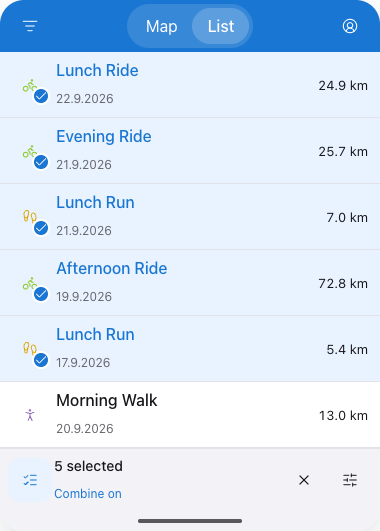
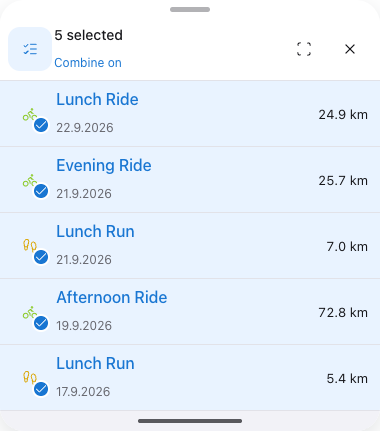
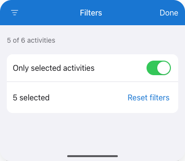

# iOS selection layouts and native verification

These are interactive-layout mockups for the [approved selection design](../activity-selection-design.md#ios-interface), prepared on 13 October 2026. They are not simulator captures or evidence of native implementation. They focus on selection controls; existing Stats/account navigation, retained Map camera and native sheet behavior remain part of the real app shell.

## List with Combine enabled

The checklist precedes the selected count in the existing footer. Clear and display options remain on the right. Selected sport icons gain a small checkmark inside their existing hit target; outside Combine, the badge and membership action disappear while row selection remains identifiable. The footer stays available when an activity is pushed.

## Map results with Combine enabled

Use the same checklist-before-count arrangement in the existing results-sheet header. Fit selection and Clear stay separate; the native grabber/detents handle sizing. The group row stays visible during route inspection and collapse. At zero selection, reduce this surface to the controls rather than leaving an empty results body.

## Only selected in Filters

The browsing Form exposes a native toggle, included in its count and Reset. The iPad filter rail offers the same setting in a popover. An active indicator beside the group count makes the restriction apparent after the editor closes. Stats does not expose this browsing restriction.

The illustrated interactions were checked for mode/badge gating, shared scope, inspection/footer retention, clear/zero state and a 320-pixel layout. The SwiftUI implementation and focused simulator verification are now recorded below. Physical iPhone/iPad/VoiceOver and release acceptance remain open.

## Implemented native captures

The following are actual production SwiftUI captures on the iPhone 18 Pro / iOS 27 simulator, Xcode 27, 13 October 2026. The harness renders phone, landscape and iPad-sized windows and explicitly sets size classes/Dynamic Type. The offline synthetic map style isolates control behavior and does not verify remote basemap loading. These differ from the HTML proposals above.

| Surface | Capture |
| --- | --- |
| Phone List, Combine on | [List footer and sport checkmarks](native/phone-list.png) |
| Completed List detail push | [Footer retained outside the outer navigation stack](native/phone-detail.png) |
| Dark List | [Dark controls and selected rows](native/dark-list.png) |
| Accessibility 3 text | [Stacked rows and persistent controls](native/large-text-list.png) |
| Landscape Map | [Persistent group header with Combine before count](native/landscape-map.png) |
| Empty Map, Combine on | [No selection controls until a route pick](native/phone-map-empty.png) |
| iPad-sized List detail | [Adjacent detail and shared footer](native/tablet-detail.png) |

`SelectionFixtureTests` consumes 72 v2 transitions. The focused run passed 61 native tests across state, store/cache/lifetime, list behavior, route hit/query and rendered selection controls; another six tests passed for summary scope and retained navigation/Map handoff. Three isolated filter tests and twelve camera/sheet checks also passed. The native result list keeps its exact position through collapse/detail transitions; camera assertions wait for the animation to finish before checking invariance. Native sport and mode targets are checked at 44 points, with Select/Deselect labels, mode On/Off, and available exit during detail/zero selection. Automated accessibility inspection supplements physical VoiceOver acceptance.

Reproduce model checks with `xcodebuild -project ios/ActivityMap/ActivityMap.xcodeproj -scheme ActivityMap -destination 'platform=iOS Simulator,name=iPhone 18 Pro' CODE_SIGNING_ALLOWED=NO -only-testing:ActivityMapTests/SelectionFixtureTests -only-testing:ActivityMapTests/SelectionBrowsingScopeTests test`. The rendered cases live in `RenderedActivityListTests.swift` (`selectionControlsSurviveListInspection`, `mapSelectionControlsDisappearUntilAnotherPick`) and `RenderedRoutePickingTests.swift` (offline query/projection adapter).

Physical-device review subsequently changed the sheet policy: Results and detail now share one stable middle height, and the collapsed sheet shows only group controls. Activity content stays hidden while collapsed; opening/back no longer resize the sheet or crossfade overlapping results/detail. Frame-sampled regressions check constant height through navigation and membership changes, manual detents and retained scroll; collapsed captures check that activity titles do not leak through. The static captures above illustrate the selection controls, not the updated animation timing. Physical-device review of this refinement remains open.

The empty Map now has no selection dock or Combine icon on either platform. The existing selection mode is retained across Clear, and controls return with the next nonempty group. The web journey and native phone/landscape/large-text cases verify this transition.

The phone tabs now share an inline native navigation header. Actual status-bar style and toolbar geometry are checked through tab switches with and without a collapsed Map sheet. [Results](native/translucent-results.png) and [detail](native/translucent-detail.png) captures over a synthetic green map show the shared sheet translucency; normal List rows retain their opaque backgrounds.
