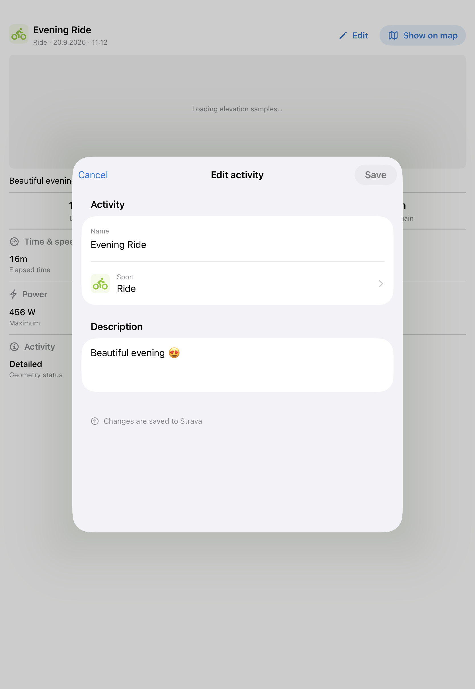

# Native activity editing — #220

The shared Map/List/Stats detail now exposes a name/description/sport editor. All headings and pushed toolbars show a direct Edit button; wide headings add a pencil icon beside the label. The form sends only changed fields to the existing authenticated PATCH endpoint, including an explicit empty description when clearing it.

Saving waits for an existing activity sync, then commits the authoritative result without moving the feed cursor. Older activity rows in a delayed feed or replacement snapshot cannot regress the committed result; later rows and tombstones still apply. Existing source-change invalidation, filter membership, map sport colors, inspection and selection reconciliation remain authoritative.

## Automated evidence

Xcode 27 / iOS 27 simulators, unsigned test host, synthetic activity/HTTP fixtures:

- iPhone 18 Pro: editing model, HTTP transport, rendered form and affected LocalStore, SyncController, SyncEngine, snapshot and summary-cache suites passed. Result: `/tmp/activitymap-editing-final.xcresult`.
- iPad Pro 11-inch (M5): rendered editor/action-layout suite passed, including normal phone/tablet sizes, larger accessibility text and preserved server-error input. Result: `/tmp/activitymap-editing-ipad-final.xcresult`.
- Rendered PNGs under `/tmp/activitymap-editing-preview` were visually inspected. These show the form and action placement; they do not certify tapping through every production presentation host.
- `git diff --check` passed. The generated DTO and backend contract are unchanged.

Tests cover changed-field omission and clearing a description; API validation limits; rate-limit and 503 deadlines; offline drafts; ambiguous-save recovery; duplicate submission; durable reopen; unchanged cursors; older/newer activity ordering; deletion/recreation and account switching; session expiry and 401 cleanup; and failed local-write rollback.

## Remaining owner/device review

- Open Edit from phone Map sheets, pushed List/Stats detail and the iPad pane; test sport-picker navigation, keyboard handling, cancellation/discard confirmation, and rotation.
- Save a chosen test activity to real Strava; verify name, cleared description and sport there, after native relaunch and on web. Check filter-hidden detail closure and route color after a sport change.
- Review VoiceOver traversal, error/success announcements and keyboard/large-text behavior on a physical device. This implementation's rendered checks are supporting evidence for #387, not accessibility acceptance.

No real Strava activity was modified during automated validation. Per-activity refresh, GPX/Open in Strava and private sharing retain their separate owners.

## Device-feedback polish — 14 October

The owner's Dev 3951 screenshot exposed inherited white toolbar styling, including unreadable Cancel and sport values. The editor now owns its semantic foreground, brand tint and navigation-bar appearance. Cancel stays blue; enabled Save is a blue capsule with white text, and disabled Save retains a readable label. Toolbar labels stay on one line, with native-sized scaling independent of the larger form text.

Name is explicitly labelled, Sport has the category icon and a visible selected value, and a searchable grouped sport screen replaces the automatic picker. Description uses a shorter growing input. Rendered regression scenarios include inherited white foreground/tint, Ride, light/dark appearance, larger text, unsaved changes and a retained server-error draft; captures were visually inspected. Follow-up test result: `/tmp/activitymap-editing-polish-final.xcresult`.

Saving now uses a centered progress card over a dimmed blocking overlay covering the editor and its toolbar. The keyboard dismisses before submission, the form keeps its layout and values, and background controls are removed from hit testing and accessibility while saving. Save retains its normal label; there is no inserted loading row. A failed save removes the overlay and restores the editable draft and error feedback. Gated-response rendered tests cover phone/tablet, dark mode and larger text, including unchanged field positions and recovery after failure. Result: `/tmp/activitymap-editing-overlay-final.xcresult`.

## Native iPad sheet presentation — 14 October

The editor was also captured inside a real SwiftUI `.sheet` on the iPad Pro 11-inch (M5) simulator, using a synthetic activity and the shared detail panel behind it. The system presented a centered, rounded 580 × 660-point modal in an 834 × 1210-point window. No custom presentation detents or sizing were applied. This captures the native modal container rather than the standalone form used in earlier rendered checks; it does not exercise tapping Edit in each production host or verify narrow multitasking/rotation behavior.

The temporary capture harness passed and was removed after capture. Result: `/tmp/activitymap-ipad-sheet-capture-3.xcresult`. The owner reviewed the screenshot and accepted the appearance.

## Direct Edit action — 15 October

The single-item activity-actions menu was replaced with a direct Edit button in compact Map sheets and pushed List/Stats toolbars. Wide headings retain their pencil and Edit label. The plain button belongs to the title row, has a minimum 44-point touch target and opens the same editor with one tap; there is no menu popover anchor to animate during scrolling or activation. Physical-device scroll/tap verification remains part of owner review.

The existing rendered editing suite passed (12 cases across three test functions), covering form and overlay behavior plus wide heading actions. Result: `/tmp/activitymap-direct-edit-rendered.xcresult`. A temporary capture harness also passed for compact Map, pushed navigation and accessibility text; before/after-scroll Map captures were visually inspected. Result: `/tmp/activitymap-direct-edit-capture.xcresult`. This checks rendered placement, not the reported physical-device touch/scroll animation.
